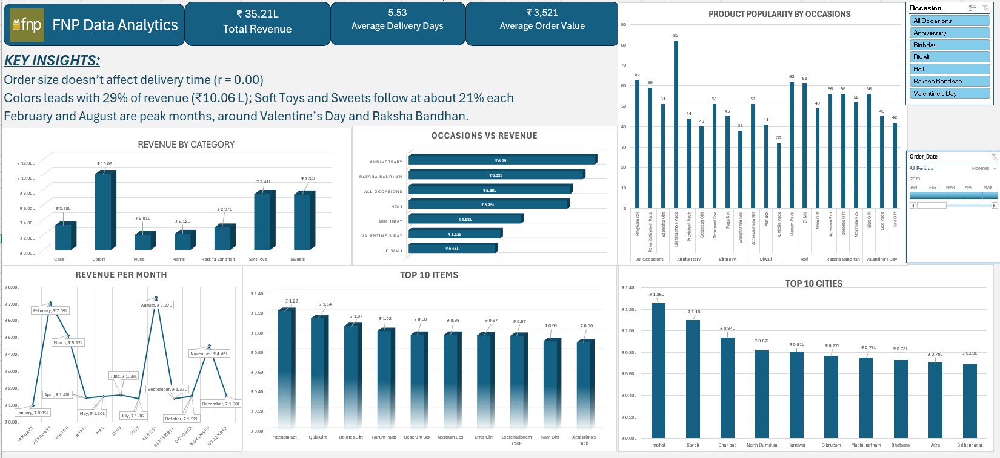

# FNP Sales Analytics: Excel Dashboard

An interactive Excel dashboard analysing 1,000 gift orders from 2023, using a synthetic dataset modelled on FNP (Ferns N Petals), to answer one question: **what drives revenue and how well are orders delivered?**

## Business questions

1. Which product categories and occasions bring in the most revenue?
2. How does revenue change month to month?
3. Which products and cities are the top performers?
4. Which products are most popular for each occasion?
5. How long do deliveries take, and does order size affect delivery time?

## Dataset

Synthetic sample data in three CSV files (`Data/`):

| File | Rows | Contents |
|---|---|---|
| `orders.csv` | 1,000 | Order and delivery dates/times, quantity, city, occasion |
| `customers.csv` | 100 | Customer details (synthetic) |
| `products.csv` | 70 | Product name, category, price, occasion |

Period: January to December 2023 · 7 categories · 7 occasions · 301 cities.
Source: *[add dataset source / credit here]*

## Tools and techniques

- **Power Query:** imported the CSV folder and combined orders with product and customer data
- **Calculated columns:** order revenue (price × quantity), delivery days, month, day and hour
- **Data Model + DAX:** `Revenue (L) = SUM(Orders[Total_Order_Revenue]) / 100000` to report revenue in lakh
- **PivotTables and PivotCharts:** Top-N filters, sorting, top 3 products per occasion
- **Slicers and timeline:** filter by occasion and order date
- **Statistics:** `CORREL` to test whether order size affects delivery time

## Key insights

| KPI | Value |
|---|---|
| Total revenue | ₹35.21 L |
| Average order value | ₹3,521 |
| Average delivery time | 5.53 days |

1. **Colors is the top category** with ₹10.06 L (29% of revenue). Soft Toys and Sweets follow at about 21% each.
2. **Revenue peaks around festivals.** 86% of August's ₹7.37 L comes from Raksha Bandhan, and Valentine's Day leads February (₹7.05 L). March and November peak with Holi and Diwali.
3. **Anniversary (₹6.75 L) and Raksha Bandhan (₹6.32 L)** are the biggest occasions.
4. **Magnam Set (₹1.22 L)** is the top product; **Imphal (₹1.26 L)** is the top city.
5. **Order size doesn't affect delivery time** (r = 0.00). One-item and five-item orders both take about 5.5 days, so delays come from other factors.

## Recommendations

- Plan inventory and campaigns ahead of Raksha Bandhan, Valentine's Day, Holi and Diwali.
- Build occasion-specific bundles around the top 3 products for each occasion.
- Investigate delivery time by city and occasion, since order size isn't the cause; about a third of orders take more than a week.

More detail: [AI Assisted Insights.pdf](AI%20Assisted%20Insights.pdf). These insights were drafted with AI assistance and checked against the data.

## Data notes

- Each product is sold for a single occasion, so product popularity is ranked within each occasion.
- *Quia Gift* and *Error Gift* each appear under two product IDs because of a data-entry typo; they are treated as one product each.
- The data covers one year, so seasonal patterns should be confirmed with more history.

## Files

| File | Description |
|---|---|
| `FNP_Data_Analytics.xlsx` | Workbook: Power Query tables, calculations and dashboard |
| `Dashboard.png` | Dashboard screenshot |
| `AI Assisted Insights.pdf` | Detailed insights and recommendations |
| `Data/` | Raw CSV files |

**Author:** [sathvik200](https://github.com/sathvik200) · *https://www.linkedin.com/in/sathvik-karanth-87651a172/*
